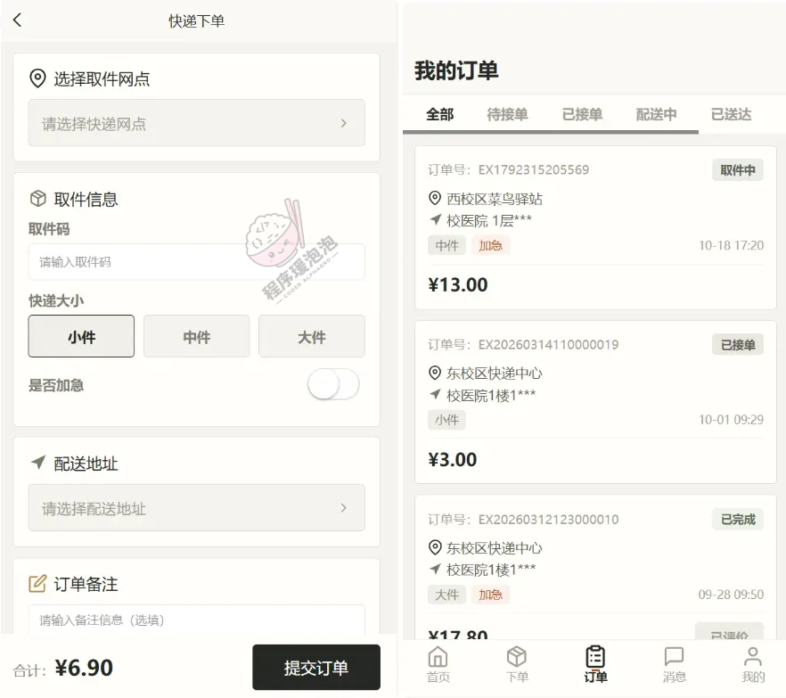
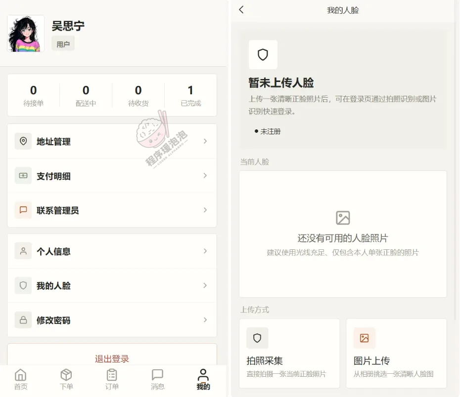
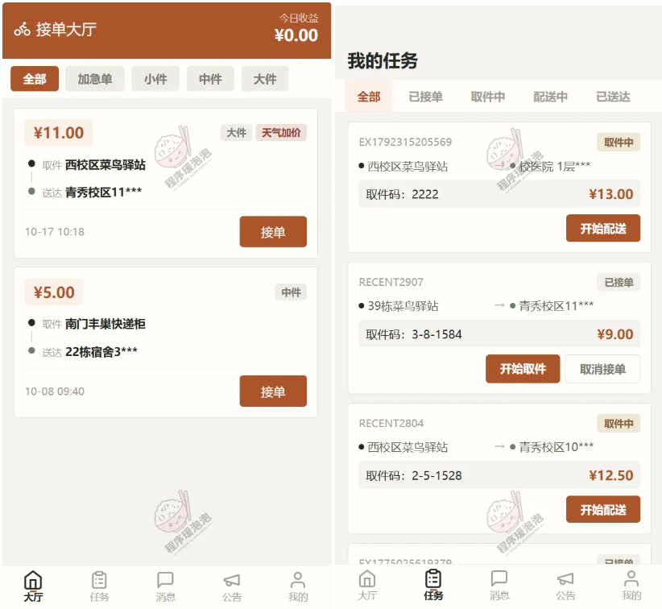
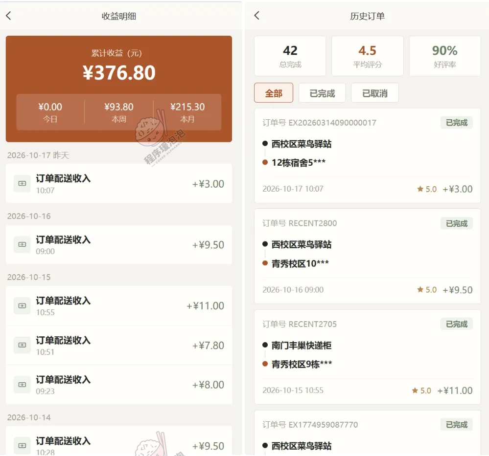
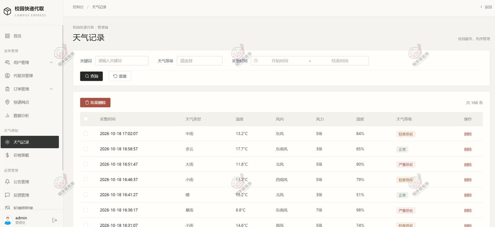
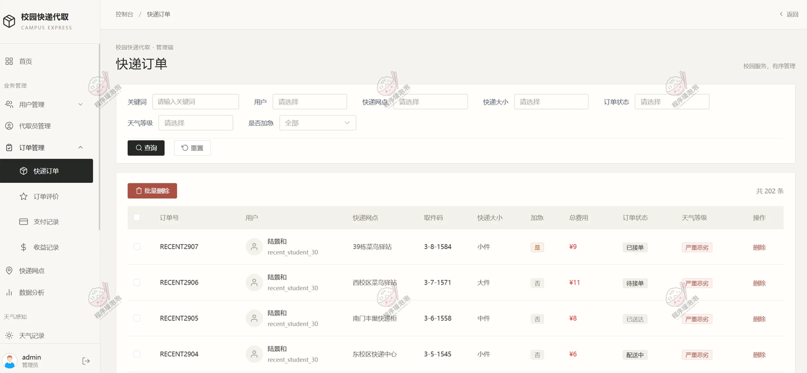
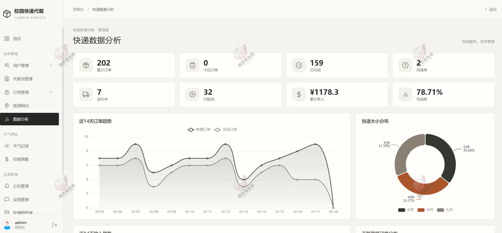
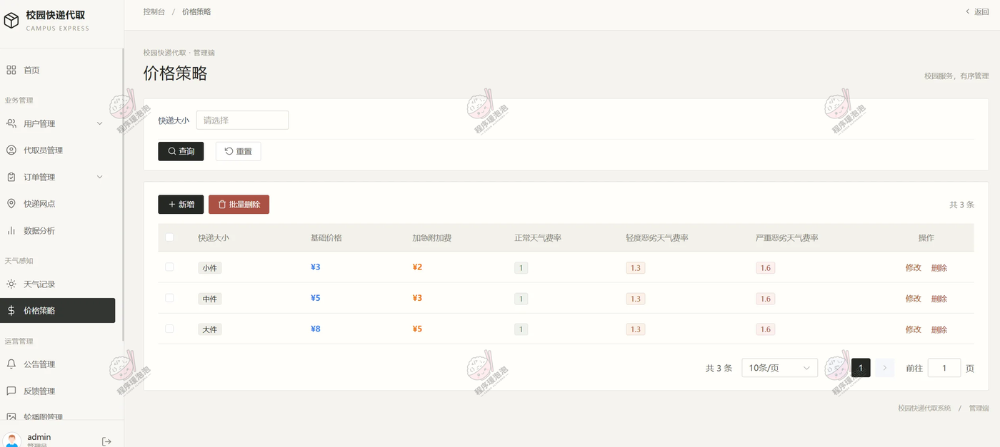

# CampusExpressDelivery
融入物联网天气感知的校园快递代取小程序
亮点：天气联动动态计价、附近网点距离算法、天气感知模拟、腾讯地图选点、百度人脸识别登录、WebSocket订单沟通、完整代取业务闭环、ECharts运营分析；
角色：用户、快递员、管理员；
数据库：15张；

所有源码均本人开发，项目是前后端分离的，所有的项目都具备了完整的业务逻辑，不仅仅局限于基础的增删改查（CRUD）操作，系统亮点众多。

本文注重于计算机毕业设计选题指导，列出题目均有源码， 大家可以去【公众号】(毕业终点站)获取或者加我【qq】(2112698948)提意见(别忘记Star哟)。备注：git

声明：仅用于学习使用，请勿用于任何商业行为！

1.系统非商用，非开源，非无偿。

2.由本人开发，如需源码，请联系以下方式，qq:2112698948。 个人网站：https://home.biyecode.com

3.项目有很多，并未全部上传，如果未找到想要的，可直接咨询。

# 融入物联网天气感知的校园快递代取小程序

> 基于 Spring Boot 3 + uni-app 的校园代取平台，微信小程序端 + 管理后台，支持用户、代取员、管理员三种角色。
> 把天气接进食费计算，用唯一流程串起下单、接单、取件、配送、收货与评价，配合人脸识别登录和实时沟通，把代取这件事搬到线上跑通。

## 一、项目简介

这是一套面向校园的快递代取应用。用户看天气、选附近网点下单，代取员接单后按取件码取件、配送并更新进度，管理员在后台维护网点、价格、天气和订单数据——三方围绕一笔代取订单协作。

系统里几个花心思的地方：

- **天气联动动态计价**：按包裹大小取基础价格，叠加加急费与"基础价格 × 天气等级费率"；下单时保存天气与费用快照，之后天气变化不会改写已有订单的费用。
- **附近网点距离算法**：用 Haversine 球面距离公式计算用户与启用网点的距离，按距离升序展示并限制数量，方便用户选附近的取件点。
- **天气感知模拟**：用定时任务模拟生成温度、湿度、风向、风力和天气等级，按正常 60%、轻度恶劣 30%、严重恶劣 10% 的权重生成天气场景，便于演示天气变化与计价的联动。
- **腾讯地图选点**：后台支持地图搜索、位置选择和逆地理编码，维护网点经纬度与位置描述，为附近网点查询提供位置数据。
- **百度人脸识别登录**：支持上传或拍照登记人脸，通过百度人脸检索和匹配分数阈值识别已登记账号，配合密码和微信登录提供多种登录入口。
- **WebSocket 订单沟通**：用户与代取员围绕订单实时发送文字消息，保留历史会话、未读状态和订单流程系统消息，方便协调取件与配送。
- **从下单到评价串起完整流程**：用户下单、代取员审核接单，到取件、配送、确认收货、收益记账和服务评价，把三种角色的实际操作步骤连成一条线。
- **ECharts 运营分析**：后台首页与快递分析页共 13 个图表，从订单、完成量、收益、天气、网点和用户增长等维度展示运营数据，支持查看近期趋势与业务分布。

## 二、技术栈

| 分层 | 技术 |
|---|---|
| 架构 | B/S、MVC、前后端分离，微信小程序端 + 管理后台，用户 / 代取员 / 管理员三角色 |
| 后端 | Java、Spring Boot 3、Spring MVC、MyBatis-Plus、MySQL、JWT、WebSocket、Spring 定时任务、百度人脸识别、微信小程序登录与绑定 |
| 后台 | Vue 3、Vite、Element Plus、Vue Router、Pinia、Axios、ECharts、SCSS |
| 小程序 | uni-app、Vue 3、Pinia、uni-ui、微信小程序 API、定位与图片上传 |
| 环境 | Windows / IDEA / JDK 17 / Maven / MySQL / Node.js / HBuilderX / 微信开发者工具 |

## 三、系统功能

### 3.1 用户端
- 注册登录：账号注册、账号密码 / 微信 / 人脸登录、密码找回
- 首页浏览：轮播图、校园天气、附近网点、最新公告与下单入口
- 网点查询：浏览快递网点位置、营业时间和联系方式，按距离了解附近取件点
- 快递下单：选择网点、填写取件码、包裹大小、配送地址与备注，可选加急并查看费用明细
- 我的订单：按状态查看订单，跟踪取件、配送、送达等处理进度
- 取消与收货：接单前取消订单，送达后确认收货并对完成订单评分评价
- 地址管理：新增、编辑、删除配送地址，设置默认地址
- 在线消息：与代取员交流取件要求和送达安排，查看聊天记录、未读消息与订单通知
- 支付明细：查看历史订单的支付金额、时间与关联订单
- 个人中心：修改头像、昵称、邮箱和联系方式，登记或移除人脸信息，绑定或解绑微信

### 3.2 代取员端
- 注册登录：注册账号后等待管理员审核，通过后接单配送
- 接单大厅：按网点、包裹大小和加急条件筛选待接订单，查看详情后接单
- 我的任务：查看已接订单，按流程更新取件中、配送中、已送达状态
- 取消接单：取件前取消已接订单，订单回到待接单状态
- 历史订单：查询历史配送任务与完成情况
- 收益明细：查看今日收益、累计收益、完成单量和每笔订单入账记录
- 在线沟通：接收用户消息，查看历史会话与订单通知
- 公告通知：查看系统公告、天气预警及服务规则调整

### 3.3 管理员端
- 数据看板：用户数、代取员数、今日订单、今日完成量及收入
- 用户与代取员管理：账号资料维护、角色设置、密码重置，代取员审核、驳回、封禁与启用
- 订单管理：快递订单、订单评价、支付记录、收益记录的查询与维护
- 快递网点：维护网点名称、联系方式、营业时间和启用状态，通过地图选择位置
- 天气记录：查看天气类型、温度、湿度、风向、风力及天气等级，查询历史天气
- 价格策略：按小 / 中 / 大件设置基础价格、加急费用及不同天气等级的附加费率
- 运营配置：公告、轮播图、反馈处理与账号设置
- 统计分析：订单与收益趋势、订单状态分布、网点与代取员排行、包裹大小及加急占比

## 四、系统截图

以下选取 10 张代表性截图，按三个角色分别展示。源文档首图为管理员登录入口页，未提供独立的系统总览图。小程序端截图为左右两页拼接的双屏图，按整张全宽展示。

### 4.1 用户端

**首页与附近网点** —— 左页展示校园天气（温度、风向、风力、湿度）、主要功能入口和按距离排列的附近网点；右页是网点列表与最新公告，含系统通知、规则更新和天气预警。

**快递下单与订单** —— 左页是下单表单，可选取件网点、填写取件码、包裹大小、加急和配送地址，底部显示合计费用；右页是我的订单，按待接单、已接单、配送中、已送达查看进度，对应天气联动的动态计价。

**消息中心** —— 左页是消息列表，展示代取员通知和未读状态；右页是与代取员的聊天界面，围绕取件和配送安排实时沟通，对应 WebSocket 订单沟通。

**个人中心与人脸登记** —— 左页是个人中心，提供地址管理、支付明细、个人信息、人脸登记等入口；右页是"我的人脸"页面，支持拍照采集或图片上传，对应百度人脸识别登录。

### 4.2 代取员端

**接单大厅与我的任务** —— 左页是接单大厅，可按加急、包裹大小筛选，订单卡片显示费用、取送地址和天气加价标签；右页是我的任务，按已接单、取件中、配送中、已送达更新状态，对应代取流程的实际操作。

**收益明细与历史订单** —— 左页汇总累计收益、今日 / 本周 / 本月收益和每笔订单配送收入；右页是历史订单，展示总完成量、平均评分、好评率及每单收入，对应收益记账与服务评价。

### 4.3 管理员端

**天气记录** —— 记录每次采集的天气类型、温度、风向、风力、湿度和天气等级，等级区分正常、轻度恶劣与严重恶劣，对应天气感知模拟，也是动态计价的数据来源。

**快递订单** —— 按用户、网点、包裹大小、订单状态、天气等级和是否加急筛选订单，列表展示取件码、总费用、订单状态和天气等级，是三种角色协作的业务枢纽。

**数据分析** —— 累计订单、今日订单、已完成、累计收入和完成率等指标卡，配合近 14 天订单趋势折线图与快递大小分布环形图，对应 ECharts 运营分析。

**价格策略** —— 按小件、中件、大件设置基础价格和加急附加值，并分别配置正常、轻度恶劣、严重恶劣天气的费率，是天气联动动态计价的配置入口。

---

文档展示 10 张截图，需要了解更多，请联系我。
